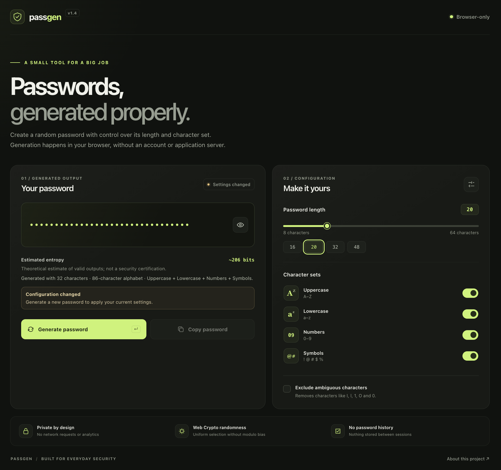

# PassGen

A small, privacy-first password generator built with vanilla HTML, CSS and JavaScript. PassGen runs in the browser, uses the Web Crypto API for random generation, and makes no network requests.


## Features

- Generate passwords from 8 to 64 characters.
- Configure uppercase, lowercase, digits and symbols.
- Uses Web Crypto and rejection sampling for unbiased character selection.
- Estimates the theoretical entropy of the valid output space.
- Copy passwords with accessible feedback and explicit configuration states.
- Runs locally without a build process or third-party runtime dependencies.

## Preview



## Quick links

- [Features](#features)
- [Run locally](#run-locally)
- [Tests](#tests)
- [Security notes](#security-notes)
- [Design decisions](#design-decisions)

## Run locally

No build process or third-party package installation is required.

```bash
python3 -m http.server 8000
```

Open <http://localhost:8000> in a modern browser. A secure context such as HTTPS or localhost is recommended for predictable Web Crypto and clipboard support.

## Tests

Node.js 20+ is recommended. Tests use Node's built-in runner.

```bash
npm test
```

The test suite covers generation constraints, character sets, entropy calculations and output metadata. The repository's GitHub Actions workflow runs tests automatically on pushes and pull requests.

## Project structure

```text
passgen/
├── index.html
├── styles.css
├── src/
│   ├── app.js
│   ├── generator.js
│   └── output-model.js
├── tests/
│   └── generator.test.js
├── docs/
│   └── screenshots/
│       └── passgen.png
├── .github/workflows/test.yml
├── package.json
├── LICENSE
└── README.md
```

## Security notes

- PassGen uses the browser's cryptographic random number generator; it does not implement its own random source or cryptographic algorithm.
- Random integer selection uses rejection sampling to avoid modulo bias. Candidate passwords are rejected until all enabled character categories are represented.
- The generated password exists in page memory and may temporarily be placed on the system clipboard when copied. The clipboard is controlled by the operating system and may be accessible to other applications.
- PassGen does not store passwords in local storage, cookies, a database or a server. Reloading the page discards the in-memory password.
- Entropy is a theoretical estimate of the valid output space, not a certification of security or protection from phishing, malware or data breaches.
- Use a unique password for every service and store it in a trusted password manager. PassGen is not a full password manager.

## Design decisions

**No framework.** The app is dependency-free and easy to inspect.

**Explicit generation.** Changing settings does not silently replace the current password or mislabel its estimate. The output uses a single immutable snapshot containing its password, generation settings and entropy metadata. The UI compares current controls against that snapshot and disables copying until the user generates a new password.

**Local-first.** Generation happens client-side. The application has no networking code, tracking or password persistence.

**Defensive validation.** Length and selected character categories are validated before generation; errors are shown near controls.

## License

MIT. See [LICENSE](LICENSE).
